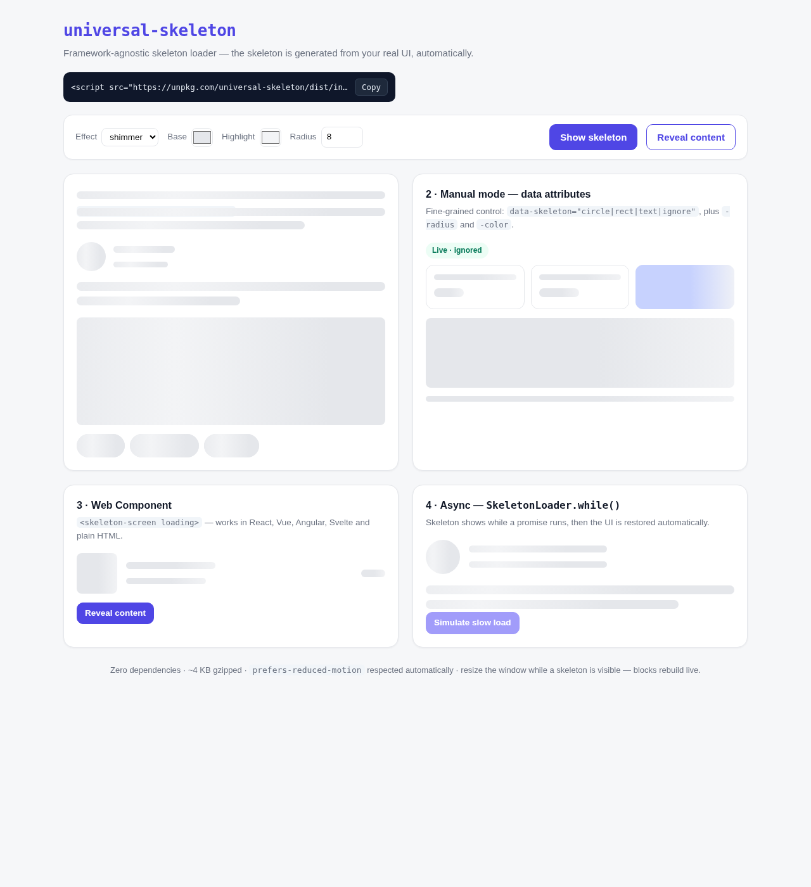

<h1 align="center">universal-skeleton</h1>

<p align="center">
  Zero-dependency skeleton loader library + interactive documentation site
</p>

<p align="center">
  <a href="https://www.npmjs.com/package/universal-skeleton"></a>
  <a href="LICENSE"></a>
  <a href="https://www.npmjs.com/package/universal-skeleton"></a>
  <a href="https://www.npmjs.com/package/universal-skeleton"></a>
  <a href="https://www.npmjs.com/package/universal-skeleton"></a>
</p>

<p align="center">
  
</p>

This repository contains **two things**:

1. **`universal-skeleton`** — a framework-agnostic skeleton loader that generates loading placeholders **automatically from your real UI**. The skeleton mirrors the exact geometry of your text, avatars, images, buttons and inputs, so it always looks "just like the UI". One package, any language, any framework — plain HTML via CDN, React / Next.js, Vue, Angular, Svelte, Lit, jQuery — through a standard Web Component or the programmatic API. **Zero runtime dependencies, ~4.3 KB gzipped.**
2. **An interactive documentation website** built with Next.js (App Router) + Tailwind CSS + shadcn/ui: a landing page, an install &amp; integration guide with sidebar navigation, live **view / code** toggles, an effects gallery of all 8 animations, an interactive playground, and full **light / dark theme** support.

## What's in this repo

```
├── src/
│   ├── app/                        Next.js App Router entry (renders the docs site)
│   ├── components/docs/            Docs site: landing, guides, effects, playground
│   ├── components/ui/              shadcn/ui primitives
│   └── lib/universal-skeleton/     Vendored library build used by the docs site
│       ├── index.esm.mjs           (copy of the built ESM bundle)
│       └── skeleton.css            (copy of the built stylesheet)
├── prisma/schema.prisma            Database schema (app scaffold, unused by the docs site)
├── db/                             Local SQLite file — gitignored
├── public/                         Static assets
└── download/
    └── universal-skeleton/         The npm package — full source, tests, demo, docs
        ├── src/                    Library source (scan engine, styles, API, Web Component)
        ├── tests/                  41 vitest unit tests
        ├── demo/index.html         Standalone playground (opens straight in a browser)
        ├── docs/                   Screenshots used by this README
        ├── build.mjs               esbuild build (ESM + CJS + CDN IIFE + CSS)
        ├── index.d.ts              TypeScript declarations
        ├── README.md               FULL package documentation (API, guides, theming)
        └── .github/workflows/      CI workflow
```

## Run the docs site locally

Requires Node 18+ (or Bun).

```bash
git clone https://github.com/Kiran-Deokar/universal-skeleton.git
cd universal-skeleton

bun install        # or: npm install
bun run dev        # or: npm run dev
```

Open **http://localhost:3000**:

- **Landing page** — what the library is, live demo of the auto-scan
- **Guide** — installation view with copy-to-clipboard code blocks, sidebar navigation, per-framework integration snippets (React / Next.js, Vue, Angular, Svelte, Lit, jQuery / legacy)
- **Effects** — gallery of all 8 animations (shimmer, wave, pulse, fade, blink, sheen, bounce, none)
- **Playground** — toggle options and watch the skeleton rebuild live
- **Light / dark theme** — toggle in the navbar; the skeletons follow the theme

Production build:

```bash
npm run build
npm start
```

## Why the library build is vendored

The docs site imports a **committed copy** of the built library (`src/lib/universal-skeleton/index.esm.mjs` + `skeleton.css`) instead of an npm dependency. This keeps the site runnable straight after `npm install` — no package build needed — while still letting you develop the library in the same repo.

After changing the library source, rebuild and refresh the vendored copy:

```bash
cd download/universal-skeleton
npm install
npm run build

cp dist/index.esm.js            ../../src/lib/universal-skeleton/index.esm.mjs
cp dist/universal-skeleton.css  ../../src/lib/universal-skeleton/skeleton.css
```

## Use the library in your own project

```bash
npm i universal-skeleton
```

```js
import { SkeletonLoader } from 'universal-skeleton';

SkeletonLoader.scan('#profile-card');                                  // skeleton appears
const user = await SkeletonLoader.while(fetchUser(), '#profile-card'); // real UI returns
```

No bundler? One script tag:

```html
<script src="https://unpkg.com/universal-skeleton/dist/index.iife.min.js"></script>
<script>
  UniversalSkeleton.SkeletonLoader.scan('#app');
</script>
```

**Full documentation** — complete API reference, the 8 effects, theming with CSS variables, data-attribute manual mode, `<skeleton-screen>` Web Component, and step-by-step guides for React / Next.js, Vue 3, Angular, Svelte and jQuery — lives in [`download/universal-skeleton/README.md`](download/universal-skeleton/README.md).

## Develop the library

```bash
cd download/universal-skeleton
npm install
npm run build      # ESM + CJS + CDN (IIFE) + CSS into dist/
npm test           # 41 vitest unit tests
npm run demo       # serve the standalone playground
```

## Deploying the docs site

The site is fully client-side — no database or environment variables are needed. Deploy to Vercel (or any Node host) with the standard Next.js flow:

```bash
npx vercel
```

The Prisma + SQLite files are part of the app scaffold and are not used by the docs site; `prisma/schema.prisma` stays committed, the local database file is gitignored.

## License

[MIT](download/universal-skeleton/LICENSE)
