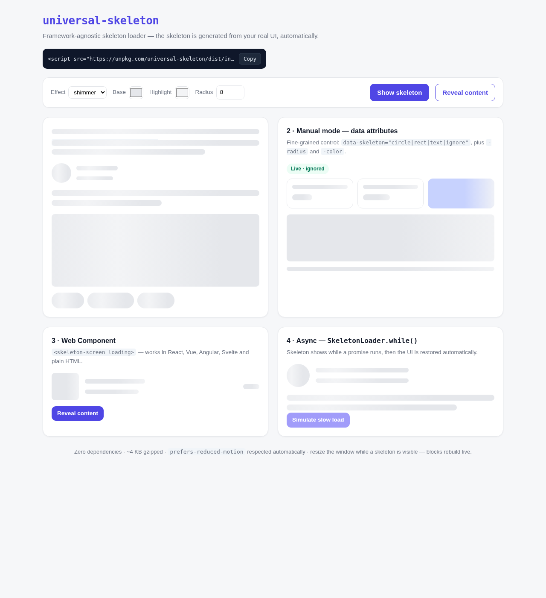

<h1 align="center">universal-skeleton</h1>

<p align="center">
  <a href="https://www.npmjs.com/package/universal-skeleton"></a>
  <a href="LICENSE"></a>
  <a href="https://www.npmjs.com/package/universal-skeleton"></a>
  <a href="https://www.npmjs.com/package/universal-skeleton"></a>
</p>

<p align="center">
  
</p>

A **framework-agnostic skeleton loader** that generates loading placeholders **automatically from your real UI** — the skeleton mirrors the exact geometry of your text, avatars, images, buttons and inputs, so it always looks "just like the UI".

Works everywhere. **One package, any language, any framework:**

- Plain HTML/JS via **CDN** (script tag — no bundler, no build step)
- **React / Next.js**, **Vue**, **Angular**, **Svelte**, **Lit**, jQuery — through a standard **Web Component**
- **TypeScript** projects get full IntelliSense out of the box (`.d.ts` included, no `@types` needed)
- **Zero runtime dependencies** — ~4 KB gzipped

```html
<!-- CDN: drop this in and you are done -->
<script src="https://unpkg.com/universal-skeleton/dist/index.iife.min.js"></script>

<script>
  UniversalSkeleton.SkeletonLoader.scan('#app');   // skeleton appears, mirroring your UI
  UniversalSkeleton.SkeletonLoader.restore('#app'); // real UI comes back
</script>
```

---

## Table of contents

- [Install](#install)
- [30-second quick start](#30-second-quick-start)
- [How the auto-scan works](#how-the-auto-scan-works)
- [API reference](#api-reference)
- [Manual mode — data attributes](#manual-mode--data-attributes)
- [Web Component `<skeleton-screen>`](#web-component-skeleton-screen)
- [Framework guides](#framework-guides)
- [Effects: 8 animation styles](#effects-8-animation-styles)
- [Theming](#theming)
- [Accessibility](#accessibility)
- [TypeScript](#typescript)
- [Browser support](#browser-support)
- [Local development](#local-development)
- [Publishing your own copy](#publishing-your-own-copy)

## Install

```bash
npm i universal-skeleton
# or
pnpm add universal-skeleton
# or
yarn add universal-skeleton
# or
bun add universal-skeleton
```

### CDN (plain JS — no install at all)

```html
<!-- jsDelivr -->
<script src="https://cdn.jsdelivr.net/npm/universal-skeleton/dist/index.iife.min.js"></script>

<!-- unpkg -->
<script src="https://unpkg.com/universal-skeleton/dist/index.iife.min.js"></script>
```

Everything is exposed on the global `UniversalSkeleton` object. As an ES module from a CDN:

```js
import { SkeletonLoader } from 'https://cdn.jsdelivr.net/npm/universal-skeleton/+esm';
```

Pin a version for production: `universal-skeleton@1.0.0/dist/index.iife.min.js`.

## 30-second quick start

**Vanilla JS (CDN)** — skeletonize anything, restore when ready:

```js
const { SkeletonLoader } = UniversalSkeleton;

// show skeleton over the whole page area or any element
const handle = SkeletonLoader.scan('#app');

// ...load your data, then:
SkeletonLoader.restore('#app');
```

**While loading a promise** — the most common pattern:

```js
// skeleton shows while the request runs, then the UI is revealed automatically
const user = await SkeletonLoader.while(fetchUser(), '#profile-card', { minDuration: 600 });
```

**HTML-only (Web Component)**:

```html
<skeleton-screen loading effect="shimmer">
  <!-- your real markup lives here; hidden while loading -->
  <article>…</article>
</skeleton-screen>

<!-- later, from any framework code: remove/add the "loading" attribute -->
```

## How the auto-scan works

`SkeletonLoader.scan(target)` walks the DOM subtree of `target` and, for every meaningful leaf element, paints a grey block that copies its **exact position and size**:

| Real element | Skeleton |
| --- | --- |
| Text (headings, paragraphs, links, labels…) | Pill-shaped bar per estimated text line; the last line is shortened for a natural look |
| `img`, `video`, `canvas` | Block with the same box; round images (border-radius 50%) become circles |
| `button`, `input`, `select`, `textarea` | Rounded rect, inheriting the element's own border-radius |
| Containers, cards, grids | Nothing — their children carry the skeleton |

The real content stays in the DOM underneath (layout untouched) and is hidden with CSS; an absolutely positioned overlay holds the blocks. `destroy()` removes the overlay and every helper class — the DOM is left exactly as it was.

Because blocks are measured with `getBoundingClientRect()`, the skeleton is pixel-accurate: same paddings, same grid gaps, same everything. Resize the container while a skeleton is visible and it rebuilds itself automatically.

## API reference

### `SkeletonLoader.scan(target, options?) → handle`

Show a skeleton over an Element or CSS selector. Scanning the same target again replaces the previous skeleton (no stacking).

```js
const handle = SkeletonLoader.scan('#dashboard', { effect: 'pulse', radius: 12 });
```

The returned `handle`:

| Member | Description |
| --- | --- |
| `handle.blocks` | Number of skeleton blocks currently painted |
| `handle.update()` | Re-measure the real UI and rebuild every block |
| `handle.setEffect(effect)` | Switch the animation at runtime (any of the 8 effects) |
| `handle.setTheme(theme)` | Switch the color palette at runtime — `'light'`, `'dark'`, `'auto'` |
| `handle.destroy()` | Remove the skeleton and restore the real UI (idempotent) |

### `SkeletonLoader.restore(target)`

Remove the active skeleton from a target. Safe no-op if none is active.

### `SkeletonLoader.isActive(target) → boolean`

True while a skeleton is showing on the target.

### `SkeletonLoader.while(source, target, options?) → Promise`

Show a skeleton while `source` (a promise or a function) runs, then remove it automatically — even if it rejects. The resolved value is returned unchanged.

```js
const data = await SkeletonLoader.while(() => api.getFeed(), '#feed', { minDuration: 400 });
```

### Options

| Option | Type | Default | Description |
| --- | --- | --- | --- |
| `effect` | `'shimmer' \| 'wave' \| 'pulse' \| 'fade' \| 'blink' \| 'sheen' \| 'bounce' \| 'none'` | `'shimmer'` | Animation style |
| `theme` | `'light' \| 'dark' \| 'auto'` | `'auto'` | Block color palette — `'auto'` follows `prefers-color-scheme` |
| `color` | string | `#e5e7eb` | Base grey of every block (any CSS color — wins over `theme`) |
| `highlightColor` | string | `#f3f4f6` | Bright band of shimmer / wave / sheen |
| `duration` | string \| number | `1.4s` | One animation cycle — CSS time (`'2s'`) or milliseconds (`900`) |
| `radius` | number | `8` | Corner radius (px) for rectangular blocks; text bars are always pills |
| `exclude` | string \| function | — | CSS selector or `(el) => boolean` predicate; matching elements get no skeleton |
| `textLines` | boolean | `true` | One bar per estimated text line; `false` draws a single bar per text element |
| `responsive` | boolean | `true` | Rebuild blocks automatically when the root is resized |
| `blockInteraction` | boolean | `true` | Block pointer events while the skeleton is visible (prevents clicks on invisible buttons) |

```js
SkeletonLoader.scan('#app', {
  exclude: '.ads, #sidebar',
  color: '#dbe2ef',
  effect: 'pulse',
});
```

## Manual mode — data attributes

Prefer explicit control? Tag any element — the scanner honors it and skips its subtree:

```html

<div class="chart" data-skeleton="rect" data-skeleton-color="#c7d2fe"></div>
<span data-skeleton="text">always a text bar</span>
<div data-skeleton="none">never skeletonized (subtree skipped)</div>
<span data-skeleton="ignore">same as none</span>
```

| Attribute | Values | Effect |
| --- | --- | --- |
| `data-skeleton` | `auto` / `circle` / `rect` / `text` / `image` / `none` / `ignore` | `circle` paints a circle, `rect` a rounded block covering the element, `text` forces text bars, `none`/`ignore` skip the element and everything inside it, `auto` uses the normal detection |
| `data-skeleton-radius` | number (px) | Override the corner radius of this block |
| `data-skeleton-color` | CSS color | Base color for this block |
| `data-skeleton-highlight` | CSS color | Shimmer band color for this block |

`data-skeleton-ignore` works anywhere, even inside an auto-scanned region — perfect for badges, spinners or anything that should stay visible.

## Web Component `<skeleton-screen>`

Wrap any markup; toggle the boolean `loading` attribute to switch between skeleton and real UI. Registered automatically in the browser (also available via `registerSkeletonScreen('my-tag')`).

```html
<skeleton-screen loading effect="shimmer" color="#e2e8f0" radius="10">
  <div class="product-card">…</div>
</skeleton-screen>
```

| Attribute | Description |
| --- | --- |
| `loading` | Present (or `""`, `"true"`, `"1"`, `"on"`) shows the skeleton; `"false"` or removal reveals the UI |
| `effect` | `shimmer` \| `wave` \| `pulse` \| `fade` \| `blink` \| `sheen` \| `bounce` \| `none` |
| `theme` | `light` \| `dark` \| `auto` — block palette (default `auto`) |
| `color` | Base block color |
| `highlight-color` | Shimmer / wave band color |
| `duration` | One animation cycle — `"2s"` or `"900"` (ms) |
| `radius` | Corner radius in px |

JS control: `document.querySelector('skeleton-screen').show(options)` and `.hide()`.

Why a Web Component? Because **it is the one component format every framework speaks** — see the guides below.

## Framework guides

### React / Next.js

```jsx
'use client'; // Next.js App Router: client component

import { useRef, useEffect, useState } from 'react';
import { SkeletonLoader } from 'universal-skeleton'; // auto-registered, no CSS import needed

export default function ProfileCard() {
  const ref = useRef(null);
  const [user, setUser] = useState(null);

  useEffect(() => {
    if (!ref.current) return;
    // re-scan whenever the loading state changes
    if (!user) SkeletonLoader.scan(ref.current, { effect: 'shimmer' });
    else SkeletonLoader.restore(ref.current);
  }, [user]);

  useEffect(() => {
    fetch('/api/user').then((r) => r.json()).then(setUser);
  }, []);

  return (
    <section ref={ref}>
      {user ? <Profile user={user} /> : null}
    </section>
  );
}
```

Or use the Web Component directly (React 19 supports custom elements natively; React 16–18 pass attributes through as strings). In SSR frameworks (Next.js, Remix), render the element only after mount — otherwise the library upgrades the server-rendered element and mutates the DOM before hydration, which trips React's hydration check:

```jsx
'use client';
import { useEffect, useState } from 'react';

export default function Product() {
  const [mounted, setMounted] = useState(false);
  const [isLoading, setIsLoading] = useState(true);

  useEffect(() => setMounted(true), []); // wait for hydration

  return mounted ? (
    <skeleton-screen loading={isLoading ? '' : undefined} effect="shimmer">
      <ProductCard product={product} />
    </skeleton-screen>
  ) : null; // or a server-rendered static fallback
}
```

For the JSX type of the custom element, import the package once anywhere in the project — `index.d.ts` declares `<skeleton-screen>` for you.

### Vue 3

```vue
<script setup>
import { ref } from 'vue';
import 'universal-skeleton'; // registers <skeleton-screen>

const loading = ref(true);
fetch('/api/user').then((r) => r.json()).then(() => { loading.value = false; });
</script>

<template>
  <skeleton-screen :loading="loading" effect="pulse">
    <UserProfile :user="user" />
  </skeleton-screen>
</template>

<script>
export default { compilerOptions: { isCustomElement: (tag) => tag === 'skeleton-screen' } };
</script>
```

> The `isCustomElement` compiler option is needed only in the component that uses the tag. In Vite-based projects you can set it globally in `vite.config.js` under `@vitejs/plugin-vue({ template: { compilerOptions } })`.

### Angular

```ts
// app.module.ts (or standalone bootstrap)
import { CUSTOM_ELEMENTS_SCHEMA, NgModule } from '@angular/core';
import 'universal-skeleton';

@NgModule({
  schemas: [CUSTOM_ELEMENTS_SCHEMA],
  // ...
})
export class AppModule {}
```

```html
<!-- any template -->
<skeleton-screen [attr.loading]="loading ? '' : null" effect="shimmer">
  <app-dashboard></app-dashboard>
</skeleton-screen>
```

Prefer a directive-free approach? `SkeletonLoader.scan(nativeElement.querySelector('.card'))` works from any component with a `ViewChild` reference.

### Svelte / SvelteKit

```svelte
<script>
  import 'universal-skeleton';
  let loading = true;
  onMount(async () => {
    data = await fetch('/api/feed').then((r) => r.json());
    loading = false;
  });
</script>

<skeleton-screen loading={loading} effect="shimmer">
  <Feed {data} />
</skeleton-screen>
```

### jQuery / legacy code / no build step

```html
<script src="https://unpkg.com/universal-skeleton/dist/index.iife.min.js"></script>
<script>
  UniversalSkeleton.SkeletonLoader.scan('#legacy-panel');
  $.get('/api/data').done(function () {
    UniversalSkeleton.SkeletonLoader.restore('#legacy-panel');
  });
</script>
```

## Effects: 8 animation styles

| Effect | Description |
| --- | --- |
| `shimmer` | Moving gradient wave (Facebook / YouTube style). **Default.** |
| `wave` | Diagonal light sweep — softer, "aurora" look |
| `pulse` | Whole-card opacity fade (Tailwind style). Cheapest to composite |
| `fade` | Staggered breathing cascade — blocks light up one after another |
| `blink` | Hard "terminal cursor" blink |
| `sheen` | One glossy light band sweeping across the whole skeleton |
| `bounce` | Gentle vertical bob (Material style) |
| `none` | Static grey blocks (print, tests, minimal UIs) |

```js
SkeletonLoader.scan('#app', { effect: 'fade', duration: 900 }); // ms or '2s'
handle.setEffect('sheen'); // switch live, without rebuilding
```

Speed is one knob — the `duration` option, the `duration` attribute on `<skeleton-screen>`, or the `--usk-duration` CSS variable.

`prefers-reduced-motion: reduce` disables all animation automatically.

## Theming

### Light, dark or follow the OS

Every skeleton has a color palette. The default is `auto` — blocks pick grey for light UIs and dark zinc for dark UIs automatically via `prefers-color-scheme`, with zero JavaScript:

```js
SkeletonLoader.scan('#app');                      // auto — follows the OS
SkeletonLoader.scan('#app', { theme: 'dark' });   // force dark blocks
handle.setTheme('light');                         // switch at runtime
```

```html
<skeleton-screen loading theme="dark" effect="shimmer">…</skeleton-screen>
```

Any explicit `color` / `highlightColor` option (or `data-skeleton-color` attribute) always wins over the palette.

### Fine-tuning with CSS variables

Global — plain CSS variables (no build tools needed):

```css
:root {
  --usk-color: #e5e7eb;      /* base grey      */
  --usk-highlight: #f3f4f6;  /* shimmer band   */
  --usk-radius: 8px;         /* rect corners   */
  --usk-duration: 1.4s;      /* animation loop */
}

/* dark surfaces — pair with theme="dark" or set per-surface: */
.dark-surface {
  --usk-color: #27272a;
  --usk-highlight: #3f3f46;
}
```

Per call — the `color`, `highlightColor` and `radius` options. Per element — `data-skeleton-color` / `data-skeleton-radius` / `data-skeleton-highlight`.

A standalone stylesheet is also shipped if you prefer CSS files over injection:

```js
import 'universal-skeleton/css';           // resolves to dist/universal-skeleton.css
// or <link rel="stylesheet" href="https://unpkg.com/universal-skeleton/dist/universal-skeleton.css">
```

## Accessibility

- The scanned root gets `aria-busy="true"` while loading and the overlay is `aria-hidden`, so screen readers announce the region as busy but never read the fake blocks.
- Real content stays in the DOM (just visually hidden), which keeps page height stable — no layout shift.
- `blockInteraction: true` (default) stops clicks from reaching invisible buttons during loading.
- Animations respect `prefers-reduced-motion`.

## TypeScript

The package ships its own `index.d.ts`. Zero configuration:

```ts
import { SkeletonLoader, SkeletonHandle } from 'universal-skeleton';

const handle: SkeletonHandle = SkeletonLoader.scan('#app', { effect: 'pulse', radius: 12 });
handle.setEffect('shimmer');
handle.destroy();
```

The source is written in plain JavaScript (as chosen), so there is no compile step to maintain — the declaration file gives TS projects full IntelliSense, and JS projects simply ignore it.

## Browser support

All evergreen browsers (Chrome, Edge, Firefox, Safari). Uses only `getBoundingClientRect`, `ResizeObserver` (guarded — skips auto-rebuild if missing), Web Components (guarded) and CSS custom properties. No polyfills required for modern apps.

## Local development

```bash
git clone https://github.com/your-username/universal-skeleton
cd universal-skeleton
npm install
npm run build      # builds ESM + CJS + CDN (iife) + css into dist/
npm test           # vitest unit tests (28 tests)
npm run demo       # serve demo/ playground, open the printed URL
```

Open `demo/index.html` directly in a browser too — it works from `file://` after a build.

## Publishing your own copy

1. Fill in `author` and the `repository`/`bugs`/`homepage` URLs in `package.json` (currently placeholders).
2. `npm whoami` (run `npm login` if needed).
3. `npm publish` — `prepublishOnly` automatically builds and runs the tests first.

> If the name `universal-skeleton` is already taken when you publish, publish a scoped package instead: rename to `@your-scope/universal-skeleton` in `package.json` and run `npm publish --access public`. CDN URLs then become `https://unpkg.com/@your-scope/universal-skeleton/...`.

## License

[MIT](LICENSE)
